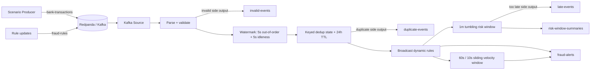

# Flink Banking Fraud Lab

İş görüşmesine hazırlanmak için tasarlanmış, yalnızca Docker gerektiren stateful stream-processing laboratuvarı. Banka işlemleri Kafka uyumlu Redpanda'ya gelir; Apache Flink event time ile işler, dinamik dolandırıcılık kurallarını broadcast state'te tutar, tekrarları ayıklar ve sonuçları exactly-once Kafka sink'lerine yazar.

## Neler gerçekten kullanılıyor?

- Apache Flink 1.20.5: DataStream API, Web UI, event time, watermark, idleness
- Keyed state + processing-time TTL: 24 saat transaction id deduplication
- Broadcast state: job restart etmeden fraud rule güncelleme
- Tumbling event-time window: hesap bazında 1 dakikalık risk özeti
- Sliding event-time window: 60 saniyelik velocity kontrolü, her 10 saniyede bir kayan pencere
- Allowed lateness ve side output: geç ama kabul edilebilir / artık kabul edilemez event ayrımı
- Checkpoint ve restart strategy: state + Kafka offset birlikte kurtarılır
- Kafka exactly-once sink: checkpoint tamamlanınca Kafka transaction commit edilir
- Redpanda Console: Kafka topic ve message UI
- Factory, Strategy ve Repository pattern; kalıcı Flink operator UID'leri
- JUnit unit testleri ve hatayı bilerek üreten senaryolar

> Sürüm notu: 8 Kasım 2026 itibarıyla Flink 2.3 güncel sürüm olsa da resmi Kafka connector'ı henüz yok. Bu laboratuvar bilinçli biçimde Flink 1.20.5 ve `flink-connector-kafka:3.4.0-1.20` uyumlu çiftini kullanır. Production'da runtime ve connector matrisi birlikte seçilir.

## Mimari



## Başlatma

Gereken tek host bağımlılığı Docker Desktop/Engine ve Compose'dur.

```bash
cd projects/flink-banking-fraud-lab
make up
docker compose ps
```

İlk build Maven bağımlılıklarını container içinde indirir. `job-submitter` tamamlandıktan sonra job `RUNNING` görünmelidir.

- Flink Web UI: <http://localhost:8081>
- Redpanda Console: <http://localhost:8080>
- Kafka host endpoint: `localhost:19092`

Flink UI'da `Running Jobs > Banking Fraud Detection` altında DAG, operator parallelism, backpressure, checkpoint geçmişi ve operator metric'lerini incele.

## Laboratuvar senaryoları

Her komut default dinamik kuralları da Kafka'ya yollar. Sonuçları Redpanda Console'dan veya `make results` ile izle.

```bash
make normal       # alert üretmeyen sıradan işlem
make country      # TR dışı ülke: COUNTRY_MISMATCH alert
make duplicate    # aynı transactionId iki kez: duplicate-events
make invalid      # schema/business validation: invalid-events
make burst        # 60 saniyede 7 işlem: velocity alert
make late         # watermark + allowed lateness sonrasına kalan event
make rule-update  # threshold 1000 TRY'den 100 TRY'ye canlı güncellenir
make results
```

`make late` kasıtlı olarak yaklaşık 7 saniye bekler. `make burst` ve window summary sonuçları watermark ilerleyince görünür; boş Kafka partition'larının watermark'ı kilitlememesi için 5 saniyelik idleness kullanılır.

Kapatma:

```bash
make down         # Kafka volume korunur
make clean        # container volume'ünü de siler
```

## Kod organizasyonu ve pattern'ler

```text
application/             Job graph ve composition root
config/                  Immutable config, typed side-output tags
domain/model/            Flink POJO'ları; framework bağımlılığı yok
domain/rule/             Strategy implementasyonları + FraudRuleFactory
infrastructure/kafka/    Source/Sink Factory'leri
infrastructure/repository/ BroadcastState arkasındaki RuleRepository
operator/                Tek sorumluluklu Flink function/operator'ları
serialization/           Merkezi JSON codec/schema
generator/               Edge-case scenario producer
```

Inheritance yalnızca ortak alert üretme davranışı için `AbstractFraudRule` içinde kullanılır. Rule seçimi `if/else` zinciri yerine Factory + Strategy'dir. Flink state erişimi domain kararlarından Repository ile ayrılmıştır. Para `double` değil minor unit (`amountMinor`) olarak `long` tutulur.

## Test ve fault-tolerance deneyi

Testler de Docker build aşamasında çalışır:

```bash
make test
```

Checkpoint oluştuğunu UI'dan doğruladıktan sonra TaskManager'ı öldür:

```bash
docker compose kill taskmanager
docker compose up -d taskmanager
```

Job restart strategy ile dönmeli ve son başarılı checkpoint'ten devam etmelidir. Kafka sink mesajları `read_committed` tüketiciyle okunduğunda yarım transaction görülmez. Alert ID'si doğal anahtardan deterministik üretildiği için downstream idempotent upsert de yapabilir.

## Önemli production farkları

Bu lab tek broker ve filesystem checkpoint ile öğrenme ortamıdır. Production için en az şunları değiştir:

- HA JobManager, çoğaltılmış Kafka ve S3/HDFS gibi dayanıklı checkpoint storage
- Secrets manager, TLS/SASL, ACL, PII masking ve audit retention
- RocksDB/ForSt backend seçimini state büyüklüğü ve latency testine göre yap
- Schema Registry + Avro/Protobuf ve compatibility politikası kullan
- Prometheus/Grafana alertleri: checkpoint age/failure, Kafka lag, backpressure, watermark lag
- Savepoint ile kontrollü upgrade; stateful operator UID'lerini değiştirme
- Kafka transaction timeout'u `checkpoint timeout + restart süresi`nden uzun tut

Ayrıntılı edge-case kataloğu ve görüşme notları: [docs/FLINK_EDGE_CASES.md](docs/FLINK_EDGE_CASES.md).
